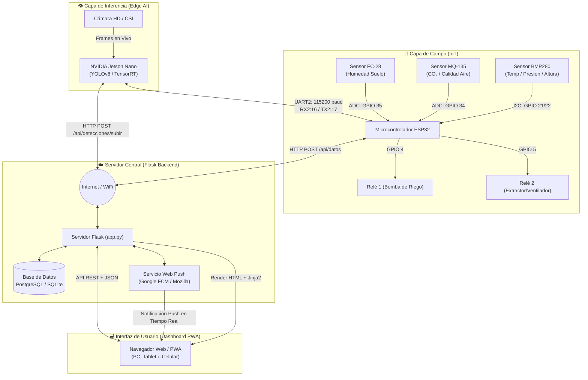
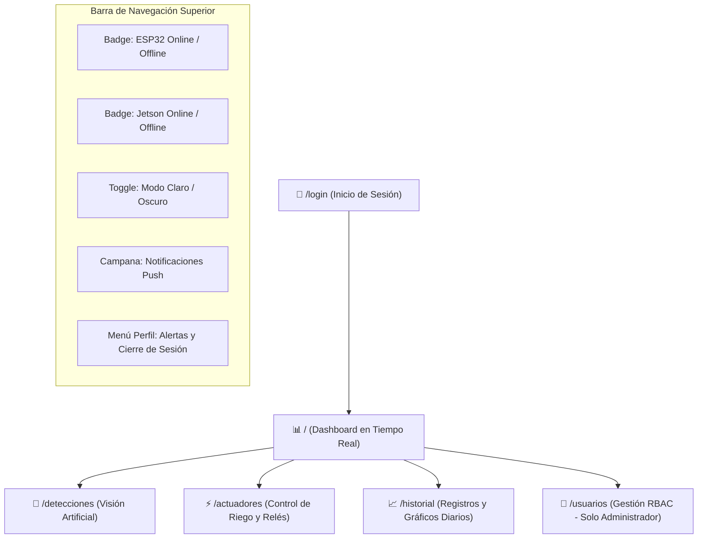
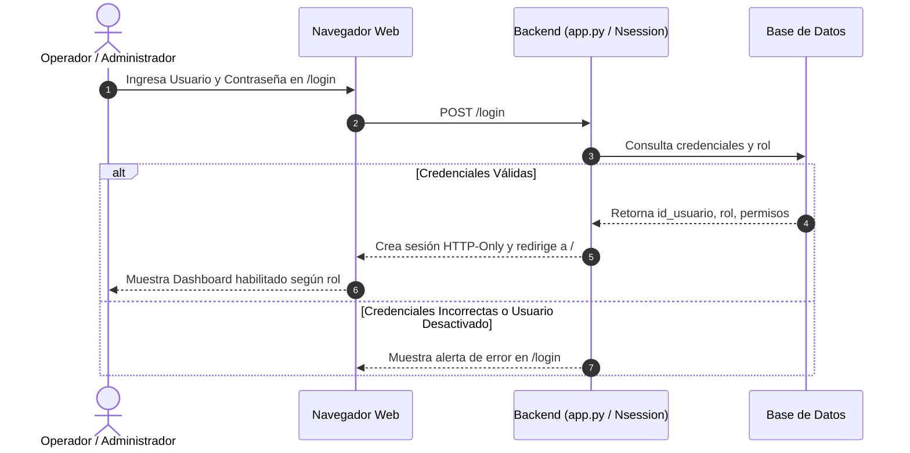
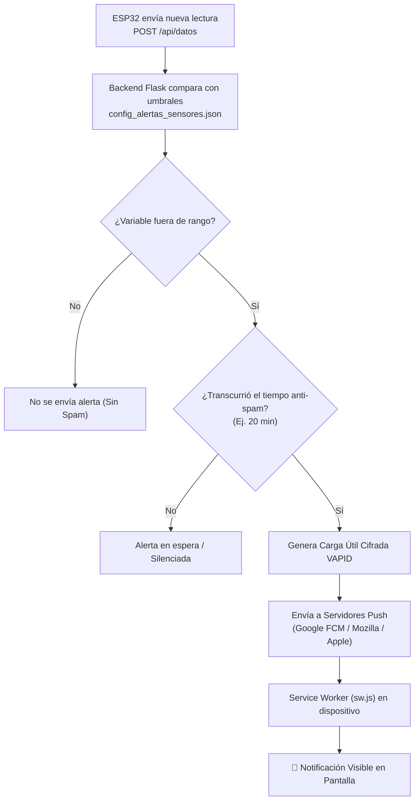
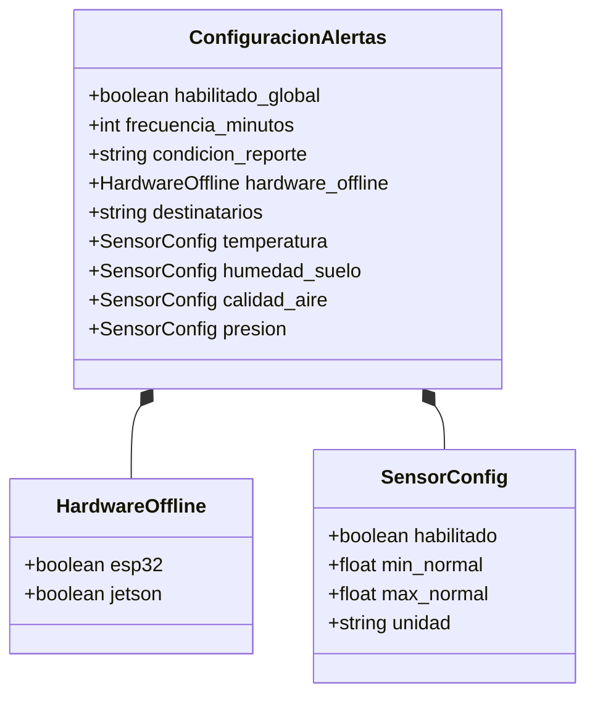
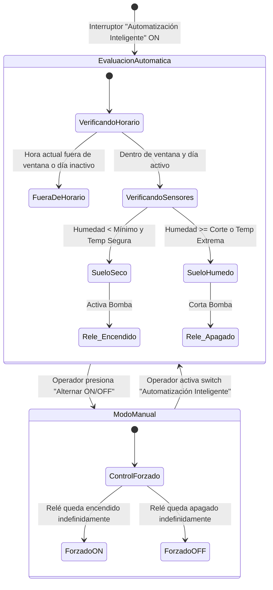
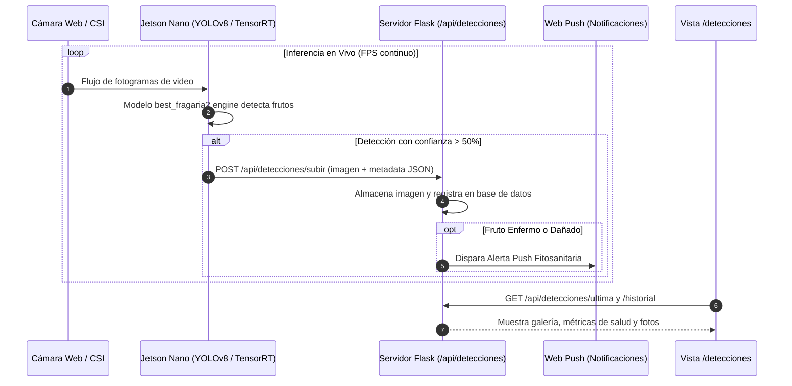
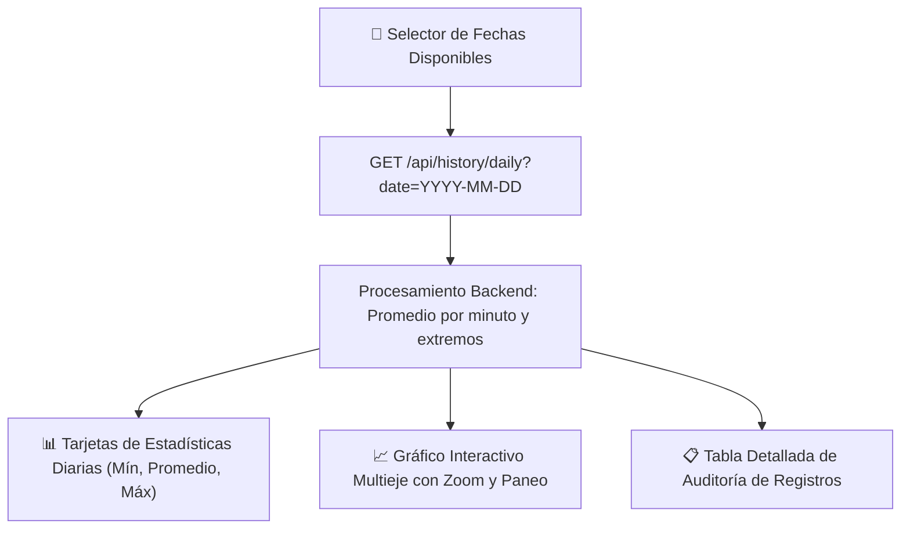

# 📖 Manual de Usuario y Referencia Técnica del Sistema IoT Bioclimático y Visión Artificial

> **Plataforma:** Sistema IoT Bioclimático & Visión Artificial para Cultivos (*Fragaria*)  
> **Versión del Software:** 2.4.0  
> **Arquitectura:** Microcontrolador ESP32 + Edge AI NVIDIA Jetson Nano + Backend Flask + Base de Datos Híbrida (PostgreSQL / SQLite) + Web Push Notifications (VAPID)

---

## 📑 Tabla de Contenidos

1. [Visión General y Arquitectura del Sistema](#1-visión-general-y-arquitectura-del-sistema)
2. [Estructura y Mapa de Navegación](#2-estructura-y-mapa-de-navegación)
3. [Módulo 1: Control de Acceso, Seguridad y Usuarios (RBAC)](#3-módulo-1-control-de-acceso-seguridad-y-usuarios-rbac)
4. [Módulo 2: Panel de Control en Tiempo Real (Dashboard - `/`)](#4-módulo-2-panel-de-control-en-tiempo-real-dashboard---)
5. [Módulo 3: Centro de Notificaciones Push y Alertas del Sistema](#5-módulo-3-centro-de-notificaciones-push-y-alertas-del-sistema)
6. [Módulo 4: Control Inteligente de Actuadores y Riego (`/actuadores`)](#6-módulo-4-control-inteligente-de-actuadores-y-riego-actuadores)
7. [Módulo 5: Visión Artificial e Inferencia de Borde (`/detecciones`)](#7-módulo-5-visión-artificial-e-inferencia-de-borde-detecciones)
8. [Módulo 6: Historial de Lecturas, Análisis y Auditoría (`/historial`)](#8-módulo-6-historial-de-lecturas-análisis-y-auditoría-historial)
9. [Módulo 7: Arquitectura de Hardware, Conexionado y Protocolos](#9-módulo-7-arquitectura-de-hardware-conexionado-y-protocolos)
10. [Módulo 8: Guía de Resolución de Problemas (Troubleshooting) y FAQ](#10-módulo-8-guía-de-resolución-de-problemas-troubleshooting-y-faq)

---

## 1. Visión General y Arquitectura del Sistema

El sistema es una solución integral diseñada para el monitoreo agronómico de precisión, la automatización del riego/climatización y el diagnóstico fitosanitario temprano en cultivos de frutilla (*Fragaria*) o entornos protegidos (invernaderos).

Combina **tres capas operativas**:
1. **Capa de Campo (Hardware & Sensores):** Adquisición continua de variables de suelo y atmósfera mediante microcontrolador **ESP32**, y conmutación de potencia mediante relés electromecánicos.
2. **Capa de Borde Inteligente (Edge AI):** Computador embebido **NVIDIA Jetson Nano** ejecutando redes neuronales convolucionales optimizadas (YOLOv8 / TensorRT) para detección visual de plagas, madurez o control gestual.
3. **Capa de Servidor y Aplicación Web (Cloud / On-Premise):** Backend desarrollado en **Python (Flask)** con persistencia en base de datos, motor de evaluación de reglas bioclimáticas y una interfaz moderna PWA con **Web Push Notifications** cifradas mediante VAPID.

### Diagrama de Arquitectura Global



---

## 2. Estructura y Mapa de Navegación

La aplicación cuenta con una barra de navegación superior (*Navbar*) persistente y reactiva, con indicadores en tiempo real y menú desplegable según los permisos del usuario conectado.



### Componentes de la Barra Superior:
* **Indicadores de Estado (Heartbeat):**
  * `ESP32 Online` (Verde) / `ESP32 Offline` (Rojo): Monitorea la última transmisión enviada por el microcontrolador (si transcurren más de 45 segundos sin datos, se marca fuera de línea).
  * `Jetson Online` (Gris/Azul) / `Jetson Offline`: Informa la actividad del computador de visión artificial.
* **Interruptor de Tema:** Alterna instantáneamente entre el diseño oscuro (*Dark Glassmorphism*) y el diseño claro, guardando la preferencia en el navegador.
* **Campana de Alertas:** Despliega el resumen de notificaciones push y el botón de suscripción del dispositivo.
* **Menú de Usuario:** Permite acceder a los modales de configuración de alertas bioclimáticas y notificaciones de visión, así como cerrar la sesión activa.

---

## 3. Módulo 1: Control de Acceso, Seguridad y Usuarios (RBAC)

El sistema implementa control de acceso basado en roles (**RBAC - Role-Based Access Control**) para asegurar que solo el personal autorizado modifique parámetros críticos de riego o usuarios.



### Matriz de Permisos por Rol

| Módulo / Función | Rol Administrador | Rol Operador / Técnico | Rol Observador |
| :--- | :---: | :---: | :---: |
| **Visualizar Dashboard (`/`)** | ✅ Permitido | ✅ Permitido | ✅ Permitido |
| **Control Manual de Relés (ON/OFF)** | ✅ Permitido | ✅ Permitido | ❌ Bloqueado |
| **Configurar Horarios y Sensores de Actuadores** | ✅ Permitido | ⚠️ Requiere permiso | ❌ Solo Lectura |
| **Configurar Umbrales de Alertas Bioclimáticas** | ✅ Permitido | ⚠️ Requiere permiso | ❌ Solo Lectura |
| **Consultar Historial y Descargas (`/historial`)** | ✅ Permitido | ✅ Permitido | ✅ Permitido |
| **Gestión de Usuarios y Roles (`/usuarios`)** | ✅ Permitido | ❌ Bloqueado | ❌ Bloqueado |

### Administración de Usuarios (`/usuarios`)
Desde esta vista exclusiva para Administradores se puede:
1. **Crear nuevos usuarios:** Asignando nombre, correo, usuario, contraseña inicial y rol.
2. **Activar / Desactivar usuarios:** Suspende temporalmente el acceso de un operador sin borrar su historial ni sus suscripciones de alertas.
3. **Editar información y permisos:** Modifica contraseñas o datos de contacto.

> [!IMPORTANT]
> Los usuarios con estado **Desactivado** son expulsados automáticamente y no pueden iniciar sesión ni recibir alertas confidenciales.

---

## 4. Módulo 2: Panel de Control en Tiempo Real (Dashboard - `/`)

El **Dashboard** es el centro de monitoreo principal del sistema. Su objetivo es brindar una visualización clara del estado del microclima y el estado operativo del hardware en tiempo real sin recargar la página.

```mermaid
graph LR
    subgraph Sensores_Lectura ["Lecturas de Sensores"]
        T["🌡️ Temperatura (°C)"]
        H["💧 Humedad Suelo (%)"]
        P["⏲️ Presión (hPa)"]
        C["🌫️ Calidad Aire (PPM)"]
        A["⛰️ Altitud Relativa (m)"]
    end

    subgraph Evaluacion ["Motor Bioclimático"]
        T & H & P & C --> EVAL{"¿Valores en Rango?"}
        EVAL -->|Sí (Normal)| OK["🟢 Estado Óptimo"]
        EVAL -->|No (Anomalía)| WARN["🔴 Alerta y Disparo Push"]
    end
```

### Tarjetas de Sensores Ambientales:

| Tarjeta | Rango Estándar Recomendado | Interpretación Agronómica |
| :--- | :---: | :--- |
| **Temperatura Ambiental** | 18.0 °C – 26.0 °C | Óptimo para el crecimiento vegetativo de la frutilla. Valores > 32 °C provocan estrés térmico; valores < 10 °C ralentizan la maduración. |
| **Humedad del Suelo** | 40% – 75% | Medido por la sonda FC-28. Por debajo del 35% el suelo requiere riego urgente; por encima del 80% existe riesgo de asfixia radicular y hongos (*Phytophthora*). |
| **Calidad del Aire / Gases** | < 450 PPM | Medido por el MQ-135. Valores elevados alertan acumulación de humo, solventes o gases tóxicos en invernadero cerrado. |
| **Presión Atmosférica** | 980 – 1030 hPa | Permite predecir cambios climáticos y frentes de lluvia. |
| **Altitud Calculada** | Metros sobre nivel del mar | Estimación barométrica basada en la presión estándar a nivel del mar (1013.25 hPa). |

### Características Clave:
* **Actualización en Vivo:** Consulta periódicamente la API (`/api/history`) para reflejar los últimos datos guardados.
* **Gráfica de Tendencia Rápida:** Muestra la curva de las últimas 50 lecturas de temperatura, humedad y presión para identificar tendencias ascendentes o descendentes de un vistazo.
* **Acceso Rápido a Relés:** Menú interactivo para encender o apagar actuadores de emergencia sin salir del panel principal.

---

## 5. Módulo 3: Centro de Notificaciones Push y Alertas del Sistema

El sistema implementa el estándar **Web Push W3C**. Esto permite que las alertas críticas lleguen a la pantalla de la computadora o al teléfono móvil del usuario, **incluso si tiene la pestaña cerrada o el navegador en segundo plano**.



### 5.1. ¿Cómo Activar las Notificaciones en su Dispositivo?
1. Haga clic en el ícono de la **Campana** en la esquina superior derecha.
2. Si el sistema muestra *"Notificaciones Desactivadas"*, presione el botón **"Activar Notificaciones"**.
3. El navegador solicitará permisos: seleccione **"Permitir"**.
4. Su navegador generará una suscripción criptográfica única (`endpoint`, `p256dh`, `auth`) que se registrará automáticamente en la base de datos vinculada a su usuario.

### 5.2. Configuración de Alertas Bioclimáticas (Modal)
Accesible desde el menú de usuario por Administradores y Operadores con permisos:



#### Parámetros Configurables:
1. **Interruptor Global:** Activa o desactiva temporalmente el despacho de todas las alertas.
2. **Frecuencia Anti-Spam (Minutos):** Intervalo de enfriamiento (*cooldown*). Evita saturar el teléfono con mensajes continuos si un sensor permanece fuera de rango durante varias horas.
3. **Condición de Reporte:**
   * **Solo Anomalías (Recomendado por defecto):** Notifica únicamente cuando una variable sobrepasa los límites configurados.
   * **Todos los Estados:** Envía resúmenes periódicos del estado del cultivo.
4. **Alerta por Desconexión de Hardware:**
   * **ESP32 Fuera de Servicio:** Notifica si el microcontrolador deja de reportar datos por más de 1 minuto.
   * **Jetson Nano Fuera de Servicio:** Notifica si la unidad de IA se apaga o pierde conexión de red.
5. **Destinatarios de Alertas:**
   * *Todos los Dispositivos:* Llega a todo el personal con suscripción activa.
   * *Solo Administradores:* Filtra las alertas operativas exclusivamente a cuentas de nivel gerencial.
   * *Usuarios Específicos:* Permite marcar individualmente a los técnicos de guardia encargados del turno.

---

## 6. Módulo 4: Control Inteligente de Actuadores y Riego (`/actuadores`)

Este módulo gobierna los dos actuadores de potencia del sistema:
* **Relé 1 (GPIO 4):** Asignado a la **Bomba de Riego** (Actuador Primario).
* **Relé 2 (GPIO 5):** Asignado al **Extractor de Ventilación** (Actuador Secundario).

### 6.1. Filosofía de Control Dual: Inteligencia vs. Mando Manual

El sistema garantiza que **la orden del operador humano siempre tiene máxima prioridad**, pero permite que el sistema trabaje de manera 100% autónoma cuando la automatización está activa.



### 6.2. Configuración de la Automatización Inteligente

Para cada relé, se configuran tres pilares de decisión:

#### 1. Modo de Activación:
* **Híbrido (Recomendado):** Debe cumplirse la ventana horaria permitida **Y** los sensores deben demandar riego/ventilación.
* **Solo Horario:** Enciende y apaga estrictamente según el reloj, ignorando las lecturas de los sensores.
* **Solo Sensores:** Enciende cada vez que el sensor detecte necesidad, a cualquier hora del día o de la noche.

#### 2. Ventana Horaria y Días Activos:
* **Hora Inicio y Fin:** Por ejemplo, de `06:30` a `08:00` (las mejores horas para riego foliar sin evaporación excesiva).
* **Selector Interactivo de Días (L - M - M - J - V - S - D):** Permite programar riego interdiario (ej. Lunes, Miércoles y Viernes).
* **Tiempo Máximo Continuo por Ciclo (Minutos):** Mecanismo de seguridad (*watchdog*) que corta el relé tras un tiempo máximo (ej. 15 minutos) para evitar inundaciones en caso de falla de la sonda de suelo.

#### 3. Reglas de Sensores:
* **Humedad de Suelo (FC-28):**
  * *Encender si < X%:* Nivel de sequía que dispara el riego (ej. 35%).
  * *Cortar en $\ge$ Y%:* Nivel de saturación donde finaliza el riego (ej. 75%).
* **Rango Seguro de Temperatura:**
  * Define un rango térmico (ej. 14 °C a 30 °C). Si la temperatura ambiental cae por debajo de 14 °C (helada) o sube de 30 °C (calor extremo con evaporación violenta), el sistema inhibe el riego para no dañar las raíces.

### 6.3. Operación en Modo Manual Inmediato
* Al hacer clic en el botón **"Alternar ON/OFF"**:
  1. El relé conmuta su estado físico de forma inmediata.
  2. La automatización se pone en pausa para respetar la voluntad del usuario.
  3. La etiqueta superior muestra claramente:
     * 🟠 **`Control Manual: Forzado ON`**
     * 🟠 **`Control Manual: Forzado OFF`**
* **Para regresar al modo automático:**
  * Basta con encender el interruptor de **"Automatización Inteligente"**.
  * La etiqueta manual desaparece de inmediato y el sistema reanuda la evaluación en vivo mostrando:
    * 🤖 **`Automatización Inteligente Activa`** (o el motivo exacto por el que el relé enciende o corta).

---

## 7. Módulo 5: Visión Artificial e Inferencia de Borde (`/detecciones`)

La **NVIDIA Jetson Nano** aporta capacidad de cómputo neuronal en el borde (*Edge AI*) para inspección visual automatizada en el surco de cultivo sin depender de servidores externos ni latencias de red.



### 7.1. Clases Fitosanitarias Detectadas

| Clase Visual | Color Identificador | Criterio Agronómico y Acción Recomendada |
| :--- | :---: | :--- |
| **Fruto Maduro (Sano)** | 🟢 Verde | Frutilla en estado óptimo de cosecha (coloración roja uniforme $\ge 80\%$). Lista para recolección comercial. |
| **Fruto Inmaduro** | 🟡 Amarillo / Azul | Fruto en desarrollo (verde o pintón). Requiere mantener plan de fertilización y monitoreo de humedad. |
| **Fruto Enfermo / Podrido** | 🔴 Rojo Alerta | Presencia de patologías como *Botrytis cinerea* (moho gris), antracnosis o pudrición blanda. Se dispara alerta push inmediata para aislamiento preventivo. |

### 7.2. Galería de Capturas y Métricas de Salud
* **Índice de Salud del Lote:** Porcentaje de frutos sanos respecto al total de detecciones registradas.
* **Ficha de Detección:** Cada registro almacena:
  1. Fotografía capturada con los recuadros delimitadores (*bounding boxes*).
  2. Nivel de certeza de la red neuronal (*Confidence score*, ej. 94.2%).
  3. Fecha, hora exacta y clase diagnosticada.

### 7.3. Notificaciones de Visión Artificial
El sistema incluye un modal de configuración específico donde se define:
* Confianza mínima para alertar (ej. $> 60\%$).
* Interruptor para alertar **únicamente enfermedades**, evitando notificaciones por frutos sanos o normales.

---

## 8. Módulo 6: Historial de Lecturas, Análisis y Auditoría (`/historial`)

Este módulo permite a los agrónomos y administradores analizar el comportamiento histórico de las variables ambientales a lo largo de días, semanas o meses.



### Funciones Principales:
1. **Calendario Dinámico:** Solo resalta los días en los que existen lecturas almacenadas en la base de datos, evitando consultas vacías.
2. **Estadísticas Diarias Automatizadas:** Calcula instantáneamente para el día seleccionado:
   * Temperatura mínima, media y máxima.
   * Promedio de humedad de suelo y nivel de hidratación.
   * Índices de calidad de aire y estabilidad barométrica.
3. **Gráfico Interactivo de Alta Resolución (Chart.js + Plugin Zoom):**
   * Permite hacer zoom con la rueda del ratón (*scroll wheel*) o mediante gestos táctiles en celulares para inspeccionar horas puntuales.
   * Permite arrastrar (*pan*) a lo largo de la línea temporal.
   * Posibilidad de ocultar o mostrar variables haciendo clic en la leyenda superior.
4. **Tabla de Auditoría:** Registro cronológico detallado con marcas de tiempo, ideal para exportación o control de calidad de cultivos.

---

## 9. Módulo 7: Arquitectura de Hardware, Conexionado y Protocolos

El hardware físico está diseñado con aislamiento y tolerancias para operación industrial o de campo.

### 9.1. Tabla Maestra de Conexiones de Hardware

| Componente | Pin Físico | Conexión en ESP32 | Conexión en Jetson Nano | Función y Protocolo |
| :--- | :--- | :--- | :--- | :--- |
| **NVIDIA Jetson Nano** | Pin 6 (GND) | **GND (Masa Común)** | Pin 6 (GND) | Referencia eléctrica común indispensable |
| | Pin 8 (UART TXD) | **GPIO 16 (RX2)** | Pin 8 | Envío de comandos de Visión Artificial (115200 baud) |
| | Pin 10 (UART RXD) | **GPIO 17 (TX2)** | Pin 10 | Recepción de telemetría y confirmaciones (ACK) |
| **Módulo Relé 1** | IN1 (Señal) | **GPIO 4 (Salida)** | — | Disparo Bomba de Riego (Lógica Inversa: LOW = ON) |
| | VCC / GND | 5V (VIN) / GND | — | Alimentación de la bobina del relé |
| **Módulo Relé 2** | IN2 (Señal) | **GPIO 5 (Salida)** | — | Disparo Extractor de Aire (Lógica Inversa: LOW = ON) |
| | VCC / GND | 5V (VIN) / GND | — | Alimentación de la bobina del relé |
| **Sensor BMP280** | SDA | **GPIO 21 (I2C SDA)**| — | Canal de datos bidireccional I2C |
| | SCL | **GPIO 22 (I2C SCL)**| — | Reloj de sincronismo I2C |
| | VCC / GND | **3.3V** / GND | — | Alimentación lógica estricta a 3.3V |
| **Sensor MQ-135** | AO (Analógico) | **GPIO 34 (ADC1_CH6)**| — | Lectura analógica de gases y CO₂ |
| | VCC / GND | **5V (VIN)** / GND | — | Alimentación del elemento calefactor a 5V |
| **Higrómetro FC-28**| AO (Analógico) | **GPIO 35 (ADC1_CH7)**| — | Lectura analógica de conductividad de suelo |
| | VCC / GND | 3.3V o 5V / GND | — | Alimentación de la placa acondicionadora |

> [!CAUTION]
> **Tierra Común Obligatoria (GND):**
> El pin **GND del ESP32** debe estar físicamente unido con un cable al **Pin 6 (GND) de la Jetson Nano** y al GND de la fuente de alimentación de los relés. Si las tierras no están conectadas entre sí, la comunicación serial UART generará tramas corruptas y los relés pueden oscilar por ruido eléctrico.

---

## 10. Módulo 8: Guía de Resolución de Problemas (Troubleshooting) y FAQ

### 10.1. Preguntas Frecuentes (FAQ)

#### ¿Por qué el botón de relé mostraba antes `(Auto OFF)`?
Originalmente, `(Auto OFF)` significaba **"Automatización Inteligente en Pausa / Desactivada"** para advertir que el relé estaba bajo control manual y no respondería a los sensores. Sin embargo, para evitar confusiones con un "temporizador de auto-apagado", el sistema ahora indica de forma directa y limpia:
* 🟠 **`Control Manual: Forzado ON`**
* 🟠 **`Control Manual: Forzado OFF`**
* 🤖 **`Automatización Inteligente Activa`** (cuando el switch automático está habilitado).

#### ¿Por qué no recibo las Notificaciones Push en mi teléfono o PC?
1. Verifique que haya presionado la **Campana** y otorgado permisos al navegador.
2. En teléfonos Android, asegúrese de que el navegador (Chrome/Edge) no tenga deshabilitadas las notificaciones en los **Ajustes del Sistema Android**.
3. Verifique que el servicio de ahorro de batería no esté suspendiendo el navegador en segundo plano.

#### ¿El sistema puede regar si se cae la conexión a Internet?
Sí. El firmware del **ESP32** cuenta con una rutina de respaldo local: si no logra comunicarse con el servidor Flask por más de 3 minutos, ejecuta una lógica autónoma de emergencia basada en la lectura analógica directa del sensor de suelo FC-28.

---

### 10.2. Matriz de Diagnóstico y Fallas

| Síntoma Observado | Causa Raíz Probable | Solución Paso a Paso |
| :--- | :--- | :--- |
| **Badge "ESP32 Offline" en rojo persistente.** | 1. El ESP32 perdió conexión WiFi.<br/>2. La URL del servidor en el firmware no es alcanzable.<br/>3. Fuente de alimentación insuficiente. | 1. Abra el Monitor Serial del ESP32 a 115200 baudios para verificar la IP asignada.<br/>2. Confirme que la red WiFi tenga acceso a Internet y que la URL `https://.../api/datos` esté activa.<br/>3. Utilice una fuente de alimentación de al menos 5V / 2A. |
| **El relé no conmuta al presionar "Alternar ON/OFF".** | 1. Cable de control desconectado (GPIO 4 o 5).<br/>2. Fuente de relé desconectada.<br/>3. Lógica inversa invertida. | 1. Revise la continuidad del cable entre el GPIO y el pin IN del módulo de relés.<br/>2. Verifique que el LED testigo del relé encienda al enviar la señal.<br/>3. Recuerde que el relé activa con nivel lógico bajo (`LOW`). |
| **La Humedad de Suelo marca 0% o 100% fijo.** | 1. Sonda desconectada del pin GPIO 35.<br/>2. Placa acondicionadora descalibrada o dañada por corrosión. | 1. Ajuste el potenciómetro azul de la placa FC-28.<br/>2. Limpie los electrodos de la sonda si presentan sales acumuladas.<br/>3. Mida con multímetro el voltaje en el pin AO (debe oscilar entre 0.8V y 3.0V según la humedad). |
| **Jetson Nano no detecta frutos o no envía capturas.** | 1. Cámara desconectada o sin permisos `/dev/video*`.<br/>2. Modelo TensorRT no encontrado.<br/>3. UART desconectado. | 1. Ejecute `ls /dev/video*` en la Jetson para confirmar que la cámara está reconocida.<br/>2. Verifique la existencia del archivo de pesos `.engine`.<br/>3. Revise la conexión cruzada: TX de Jetson va a RX2 (GPIO 16) del ESP32. |
| **Error en consola: "renotify flag must specify a tag".** | Parámetros del Service Worker desactualizados en caché del navegador. | Ingrese a `chrome://serviceworker-internals` o abra DevTools (`F12`), vaya a la pestaña *Application* -> *Service Workers*, haga clic en **"Unregister"** y recargue la página para registrar la última versión de `sw.js`. |

---

*Manual elaborado y actualizado para el proyecto IoT y Visión Artificial Bioclimática Fragaria.*

