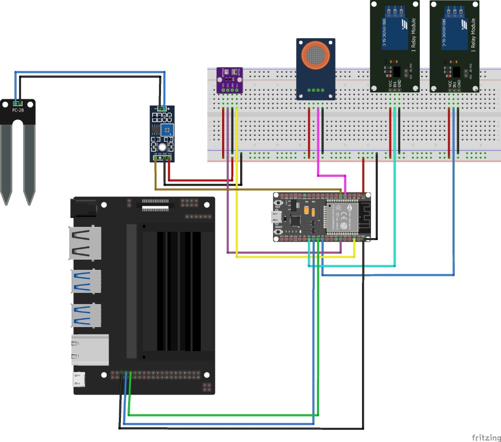
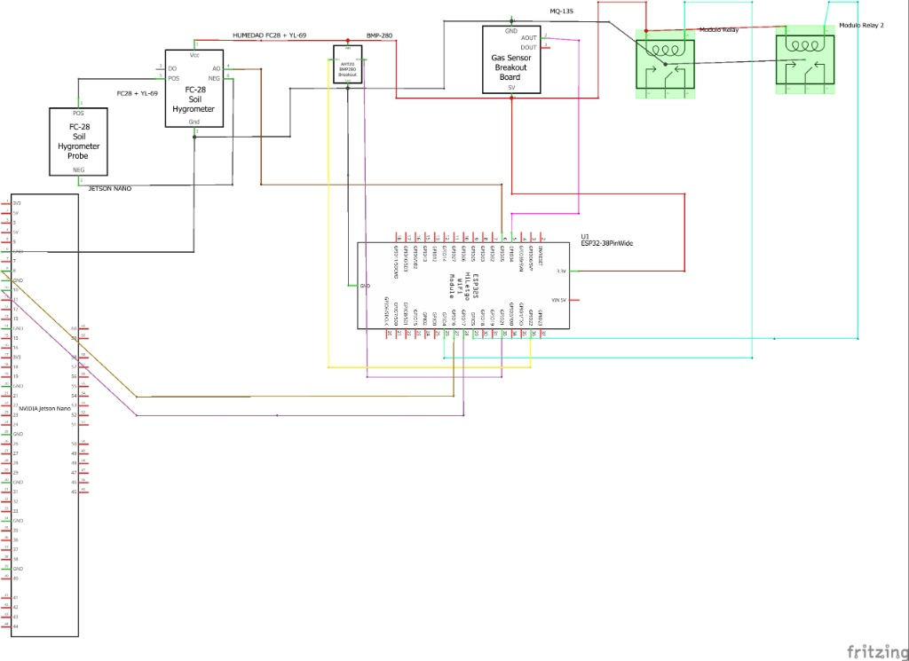
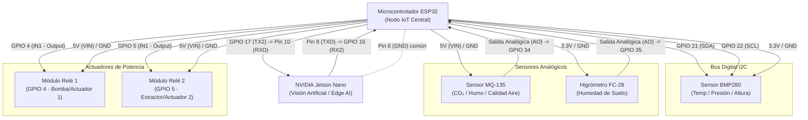

# Documentación del Hardware y Conexión del Proyecto

Esta documentación describe detalladamente cada uno de los componentes de hardware (microcontrolador, computador embebido para IA, sensores, actuadores y cableado) utilizados en el sistema IoT y visión artificial del proyecto (basado en [arduino_con_jetson.ino](file:///c:/Users/Usuario/Documents/python/proyectotecnologia/proyectoiot/arduino_con_jetson.ino)). Incluye el esquema de conexionado eléctrico, diagramas de Fritzing (esquemático y protoboard) y la lógica de control híbrida (Web + Visión Artificial + Respaldo Autónomo).

---

## 1. Detalle de Componentes y Materiales Utilizados

### 🧠 1. Microcontrolador Principal: ESP32 (38 Pines / NodeMCU-32S)
El **ESP32** actúa como el nodo concentrador y controlador de campo. Gestiona la adquisición de datos de los sensores, controla los actuadores mecánicos y establece comunicación dual (inalámbrica con el servidor Web y serial con la Jetson Nano).
* **Módulo Wi-Fi:** Envía la telemetría periódica al servidor Flask vía HTTP POST (`/api/datos`) y recibe comandos remotos en formato JSON.
* **Bus Serial UART2 (HardwareSerial):** Comunica bidireccionalmente con la **NVIDIA Jetson Nano** a **115200 baudios** usando los pines dedicados:
  * **RX2 (GPIO 16):** Recibe comandos de activación/desactivación enviados por el algoritmo de visión artificial de la Jetson Nano.
  * **TX2 (GPIO 17):** Envía confirmaciones (*ACK*) y telemetría hacia la Jetson Nano.
* **Puerto I2C:** Pines **GPIO 21 (SDA)** y **GPIO 22 (SCL)** para leer digitalmente el sensor barométrico y térmico BMP280.
* **Conversores ADC (12 bits):** Lee voltajes analógicos de 0 a 3.3V (resolución 0 a 4095) en **GPIO 34** (MQ-135) y **GPIO 35** (Humedad de suelo).
* **Salidas Digitales de Potencia:** Gobierna dos módulos de relé independientes mediante **GPIO 4** (Relé 1) y **GPIO 5** (Relé 2).

---

### 👁️ 2. Computador de Borde para IA: NVIDIA Jetson Nano
La **NVIDIA Jetson Nano** es la unidad de procesamiento neuronal y visión por computadora en el borde (*Edge AI*).
* **Función en el proyecto:**
  * Procesa el flujo de video en tiempo real desde la cámara para la detección sanitaria de frutos de frutilla (*Fragaria*) mediante modelos **YOLOv8** y/o detección de gestos manuales con MediaPipe/OpenCV.
  * Cuando se detecta un patrón o gesto específico, genera tramas de comando UART estructuradas y las transmite al ESP32 a través de su puerto serial de hardware `/dev/ttyTHS1`.
* **Pines utilizados en el Header J41 (40 pines):**
  * **Pin 6 (GND):** Referencia de masa común con el circuito de control.
  * **Pin 8 (UART1 TXD):** Transmisión de datos seriales hacia el pin **RX2 (GPIO 16)** del ESP32.
  * **Pin 10 (UART1 RXD):** Recepción de respuestas/ACK desde el pin **TX2 (GPIO 17)** del ESP32.

---

### 🔌 3. Actuadores: Doble Módulo Relé de 1 Canal (Relé 1 y Relé 2)
Interruptores electromecánicos que permiten conmutar cargas eléctricas externas de mayor potencia (bombas de agua, electroválvulas de riego, ventiladores de extracción, calefactores o iluminación).
* **Relé 1 (Control en GPIO 4):**
  * Asignado al actuador principal (por ejemplo, bomba de riego por goteo o dedo índice en control gestual).
* **Relé 2 (Control en GPIO 5):**
  * Asignado al actuador secundario (por ejemplo, extractor de aire, humidificador o dedo medio en control gestual).
* **Lógica de Activación:**
  * Ambos relés operan con **lógica inversa** estándar (`RELAY_ON = LOW`, `RELAY_OFF = HIGH`). Un pulso a masa activa la bobina y cierra los contactos normalmente abiertos (NO).

---

### 🌡️ 4. Sensor BMP280 (Temperatura, Presión y Altitud)
Sensor barométrico digital de alta precisión fabricado por Bosch.
* **Variables medidas:** Temperatura ambiente en °C, presión barométrica en hPa y cálculo relativo de altitud en metros.
* **Interfaz de comunicación:** **I2C** con dirección física `0x76` (o `0x77` de respaldo). Conectado a SDA (GPIO 21) y SCL (GPIO 22). Alimentación exclusiva a **3.3V**.

---

### 🌫️ 5. Sensor MQ-135 (Calidad del Aire, $CO_2$ y Humo)
Sensor electroquímico con resistencia interna de dióxido de estaño ($SnO_2$) sensible a gases contaminantes ($NH_3$, alcohol, humo, $CO_2$).
* **Conexión:** La salida analógica **AO** se conecta al pin **GPIO 34 (ADC1_CH6)**.
* **Alimentación:** Requiere **5V (VIN)** continuo para alimentar su resistencia calefactora interna.

---

### 🌱 6. Sensor Higrómetro de Suelo (FC-28 + Sonda YL-69)
Mide el contenido volumétrico de agua en el sustrato mediante conductividad eléctrica entre dos electrodos sumergidos en la tierra.
* **Conexión:** La salida analógica **AO** se conecta al pin **GPIO 35 (ADC1_CH7)**.
* **Calibración:**
  * `SOIL_DRY_VAL = 4095` (Tierra completamente seca / aire libre = 0% de humedad).
  * `SOIL_WET_VAL = 1000` (Tierra saturada de agua = 100% de humedad).

---

## 2. Esquema de Conexiones del Hardware

### 📋 Tabla Maestra de Asignación de Pines

| Dispositivo / Sensor | Pin del Componente | Conexión en ESP32 | Conexión en Jetson Nano | Descripción y Protocolo |
| :--- | :--- | :--- | :--- | :--- |
| **NVIDIA Jetson Nano** | Pin 6 (GND) | GND | Pin 6 | Referencia de tierra común |
| | Pin 8 (UART TXD) | **GPIO 16 (RX2)** | Pin 8 | Envío de comandos de Visión Artificial (115200 baud) |
| | Pin 10 (UART RXD) | **GPIO 17 (TX2)** | Pin 10 | Retorno de confirmaciones (ACK) |
| **Módulo Relé 1** | VCC | 5V / VIN | — | Alimentación de la bobina (5V) |
| | GND | GND | — | Referencia a masa |
| | IN1 (Control) | **GPIO 4** | — | Señal digital de activación (Lógica Inversa: LOW = ON) |
| **Módulo Relé 2** | VCC | 5V / VIN | — | Alimentación de la bobina (5V) |
| | GND | GND | — | Referencia a masa |
| | IN1 (Control) | **GPIO 5** | — | Señal digital de activación (Lógica Inversa: LOW = ON) |
| **BMP280 (Barómetro)**| VCC | 3.3V | — | Alimentación lógica (3.3V estricto) |
| | GND | GND | — | Referencia a masa |
| | SDA | **GPIO 21** | — | Línea de datos bidireccional I2C |
| | SCL | **GPIO 22** | — | Línea de reloj sincronizado I2C |
| **MQ-135 (Aire/CO₂)** | VCC | 5V / VIN | — | Alimentación del calefactor (5V) |
| | GND | GND | — | Referencia a masa |
| | AO (Salida Analógica)| **GPIO 34** | — | Entrada analógica ADC1_CH6 |
| **FC-28 (Humedad Suelo)**| VCC | 3.3V o 5V | — | Alimentación de la placa acondicionadora |
| | GND | GND | — | Referencia a masa |
| | AO (Salida Analógica)| **GPIO 35** | — | Entrada analógica ADC1_CH7 |

> [!IMPORTANT]
> **Tierra Común (Common Ground):** Es fundamental que el pin GND de la **NVIDIA Jetson Nano (Pin 6)** esté conectado a la misma línea de tierra (GND) del **ESP32** y de los módulos de relé. Sin una referencia de masa compartida, las señales UART flotan y se generan errores de comunicación.

---

### 🖼️ Diagramas de Conexión en Fritzing

A continuación se presentan los diagramas oficiales de montaje realizados en Fritzing:

#### Diagrama de Montaje en Protoboard (Breadboard View)

#### Diagrama Esquemático de Circuitos (Schematic View)

---

### 🗺️ Diagrama de Bloques e Interconexión Eléctrica

---

## 3. Resumen de Funcionamiento y Jerarquía de Control

El firmware del ESP32 implementa una arquitectura de control por capas con prioridades bien definidas:

1. **Prioridad 1: Modo Manual desde la Web (Dashboard Flask)**
   * Si el usuario operador activa manualmente el Relé 1 o el Relé 2 desde el panel web, el servidor envía los comandos `relay_command` o `relay_2_command`.
   * El ESP32 acata inmediatamente la orden web e ignora temporalmente los comandos de visión artificial de la Jetson Nano para garantizar seguridad operativa manual.

2. **Prioridad 2: Modo Inteligente por Visión Artificial (NVIDIA Jetson Nano)**
   * Cuando el sistema está en **Modo Automático**, la Jetson Nano procesa imágenes de la cámara (detección de dedos/gestos o diagnóstico visual de frutos Fragaria).
   * Al clasificar un evento, envía una trama JSON por UART al ESP32 (por ejemplo: `{"cmd": "rele1_on"}`, `{"cmd": "rele2_on"}`).
   * El ESP32 conmuta los relés correspondientes y devuelve un acuse de recibo (`{"ack": "ok"}`). Si la Jetson deja de transmitir por más de 3.5 segundos, se activa el timeout de seguridad.

3. **Prioridad 3: Modo Autónomo de Respaldo Local (Fallo de Red o Pérdida de Jetson)**
   * Si se pierde la conexión Wi-Fi con el servidor y la Jetson no envía comandos, el ESP32 entra en modo de protección biológica autónoma:
     * Si la temperatura leída por el sensor BMP280 es **$\ge 27.0^\circ\text{C}$**, activa automáticamente ambos relés para mitigar el sobrecalentamiento.
     * Si la temperatura desciende por debajo de **$27.0^\circ\text{C}$**, apaga los relés para ahorrar energía.
